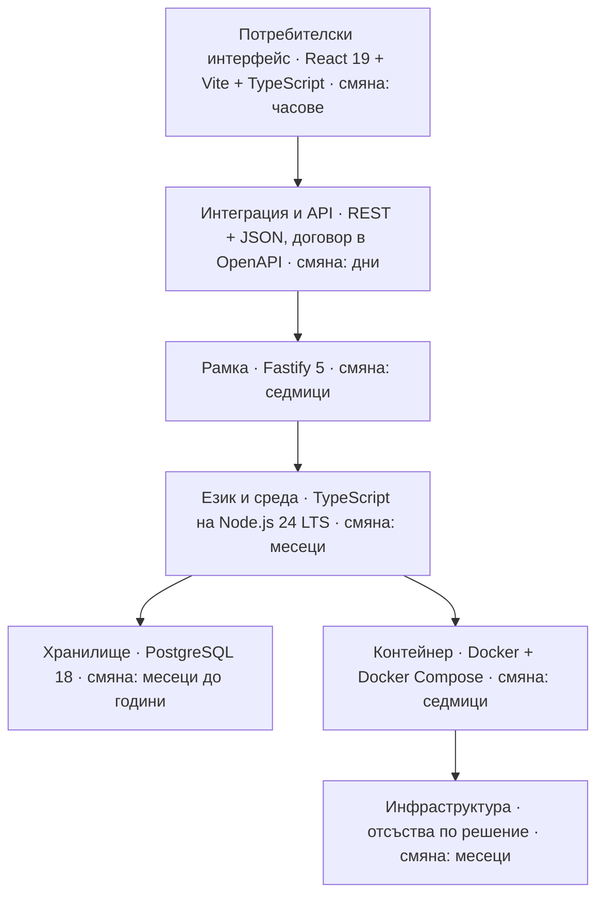

# Технологичен профил — Енерго-отчет

Етап Е1 · раздел 1.10 · версия от 2026-11-26

## 1. Системата

**Какво прави.** Енерго-отчет приема показания от интелигентни електромери, пази ги в
дневник, в който само се добавя, и показва консумацията по период. Когато показание е
необичайно (по-малко от предишното или скок над праг), системата вдига сигнал.

**За кого.** За оператор на мрежа, който проверява консумацията и сигналите. В проекта
електромерите са заменени от симулатор. Данните са само синтетични.

**Части.** Три взаимодействащи части и едно постоянно хранилище:
симулатор на електромер → услуга за показания → PostgreSQL; табло → услуга за показания.

**Архитектурен стил.** Модулен монолит: една услуга с вътрешни модули „приемане“,
„отчети“ и „сигнали“. Решението и цената му са в [ADR-0001](../adr/0001-modulen-monolit.md).

## 2. Слоевете

> **Вид: СЛОЕВЕ.** Въпрос: кой слой върху кой стои и коя е цената за смяната на всеки.

Подредба по цена на смяната (най-скъпият първи): хранилище → език → инфраструктура →
рамка, контейнер → API → интерфейс. Хранилището е най-скъпо, защото данните остават в
неговия модел и при смяна трябва да бъдат пренесени, а не само кодът да бъде пренаписан.

### Хранилище на данни — PostgreSQL 18
- **Модел на достъп:** много записи само чрез добавяне, пристигат подредени по време;
  четене по „електромер + интервал“; сумиране по период; без промяна на стари записи.
- **Критерии, които натежаха.** *Съответствие с ISO/IEC 25010 (цялост):* правата на
  потребителя на приложението се ограничават до `INSERT` и `SELECT` — „само добавяне“ се
  гарантира от базата, а не само от кода. *Време за смяна:* растежът към времеви редове
  става с разширението TimescaleDB върху същата база, без пренос на данни.
  *Зрялост:* поддръжка на всяка главна версия 5 години; версия 18 — до ноември 2030 г.
- **Отхвърлени.** MySQL 8.4 — няма BRIN индекс (малък индекс за данни, подредени по
  време) и няма път към времеви редове чрез разширение на същата база. SQLite —
  вграден в процеса, а системата изисква отделно постоянно хранилище, достъпно за
  повече от една част.
- **Преразглежда се, ако** таблицата с показания надхвърли 100 милиона реда или
  заявката за месечна консумация на един електромер стане по-бавна от 1 секунда.

### Език и среда за изпълнение — TypeScript на Node.js 24 LTS
- **Критерии.** *Оперативна съвместимост:* един език в интерфейса и в услугата —
  типът „показание“ се описва веднъж и се ползва от двете страни. *Съответствие с
  ISO/IEC 25010 (ефективност):* приемането на показания е предимно чакане на мрежа и
  база — точно случаят, за който е направен асинхронният модел на Node.js. *Зрялост:*
  линия с дългосрочна поддръжка до 30 април 2028 г. *Кадри:* JavaScript/TypeScript е
  сред най-разпространените езици на пазара на труда.
- **Отхвърлени.** C# на .NET 10 — по-строги типове по време на изпълнение, но два езика
  в един проект означават договорът за данните да се описва и поддържа два пъти.
  Python с FastAPI — същият проблем с два езика.
- **Решение в данните, следващо от избора:** числата в JavaScript са с плаваща запетая,
  затова енергията се пази като **цели ватчасове (Wh)**, не като дробни kWh.
- **Преразглежда се, ако** се появи изчисление, тежко за процесора (напр. прогнозиране),
  или преди края на поддръжката на линия 24 — най-късно до 30 април 2028 г.

### Рамка — Fastify 5
- **Критерии.** *Оперативна съвместимост:* всеки маршрут се описва с JSON Schema;
  същата схема валидира входа и поражда OpenAPI документа — договорът и проверката не
  могат да се разминат. *Наблюдаемост:* вградени структурирани логове в JSON с
  идентификатор на всяка заявка.
- **Отхвърлени.** Express — валидиране и OpenAPI идват от отделни библиотеки, които могат
  да се разминат с кода. NestJS — тежка рамка с много конвенции за пет крайни точки.
- **Преразглежда се, ако** услугата премине петдесет крайни точки и екипът стане повече
  от трима души — тогава конвенциите на по-тежка рамка започват да се изплащат.

### Интеграция и API — REST + JSON по HTTP, договор в OpenAPI 3
- **Критерии.** *Оперативна съвместимост:* HTTP и JSON се поддържат от всеки уред,
  език и браузър. *Проверимост:* OpenAPI е машинно четим договор.
- **Отхвърлени.** MQTT — индустриалният стандарт за уреди, но изисква брокер като
  допълнителен компонент, без полза при симулатор. gRPC — браузърът не го поддържа
  директно.
- **Граница:** важи за симулатор. С истински уреди приемането минава през MQTT.

### Потребителски интерфейс — React 19 + Vite + TypeScript
- **Критерии.** *Зрялост и общност:* най-широко използваната библиотека за интерфейси,
  с готови компоненти за графики. *Оперативна съвместимост:* общите типове с услугата.
  *Време за смяна:* часове — най-евтиният слой.
- **Отхвърлени.** Страници, пораждани от сървъра — таблото опреснява графики без
  презареждане. Blazor — изисква .NET, а услугата е на Node.js.

### Контейнер и оркестрация — Docker + Docker Compose
- **Критерии.** *Работоспособност от трето лице:* цялата система тръгва с една команда.
  *Възпроизводимост:* всеки образ е прикован по версия и по отпечатък (digest), така
  че изграденото утре е същото като описаното днес.
- **Отхвърлени.** Kubernetes — оркестрация за десетки услуги при три контейнера.
  Указания за ръчна инсталация — зависят от локалното състояние на машината.
- **Преразглежда се, ако** системата трябва да върви на повече от една машина.

### Инфраструктура — отсъства по решение
Системата няма потребители. Облачна среда би добавила разход и тайни за достъп в
конвейера без полза за целта. Системата върви на всяка машина с Docker; конвейерът — на
хостнатите машини на GitHub Actions (ubuntu-24.04).
**Отхвърлено:** облачна услуга за контейнери — изисква акаунт, плащане и ключове.
**Преразглежда се, ако** системата получи реални потребители.

## 3. Конвейер и списък на съставките

GitHub Actions при всяка промяна: инсталира зависимостите по заключения файл →
проверява типовете → пуска тестовете → изгражда образа → поражда списък на съставките
(SBOM, формат CycloneDX) → качва образа и SBOM като артефакт.

## 4. Криптография

- **Къде:** TLS между уред и услуга и между браузър и услуга — в продукция. Локално
  системата работи по HTTP; това е съзнателно и е записано тук.
- **Сменя ли се алгоритъмът без преработка:** да. TLS се настройва в обратния прокси пред
  услугата, не в нашия код.
- **Защо има значение:** профилът на консумация разкрива навиците на домакинството.
  Записан днес трафик може да бъде дешифриран по-късно с квантов компютър; преходът към
  постквантов обмен на ключове става на ниво TLS библиотека.

## 5. Граница на валидност на профила

Профилът важи за учебна система с до хиляда симулирани електромера, едно разгръщане и
синтетични данни. Какво се променя при сто пъти по-голямо натоварване — в
[natovarvane-100x.md](natovarvane-100x.md).

## Източници
- Node.js — график на версиите: https://nodejs.org/en/about/previous-releases
- PostgreSQL — политика за версиите: https://www.postgresql.org/support/versioning/
- Fastify — валидиране и сериализация: https://fastify.dev/docs/latest/Reference/Validation-and-Serialization/
- Жеков, Б. Софтуерни технологии, Част 1, раздели 1.1 и 1.10; Фигура 1.2.
